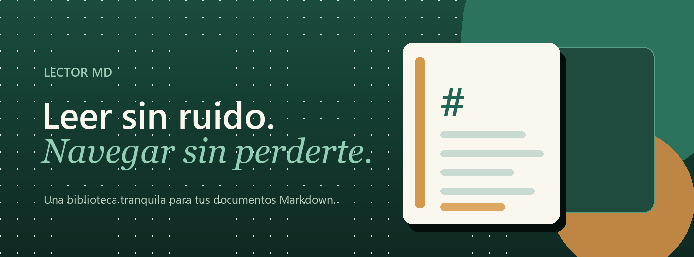

# Bienvenido a Lector MD

Una biblioteca tranquila para tus archivos **Markdown**. Sin editores, sin paneles
innecesarios y sin distracciones: solo tus documentos, bien ordenados y listos para leer.

> **Empieza por aquí.** Esta carpeta de ejemplo existe para que explores la aplicación.
> Abre los documentos del panel izquierdo, prueba la búsqueda y cambia el tema desde
> el menú de la esquina superior.

## Tu primera biblioteca

1. Pulsa **Abrir carpeta** y elige la carpeta donde guardas tus notas.
2. Navega por las carpetas del panel izquierdo.
3. Haz clic en cualquier archivo `.md` para leerlo.
4. Usa el índice de la derecha para saltar entre secciones.

Lector MD recuerda la última carpeta y el último documento que abriste, para que
puedas continuar donde quedaste.

## Lo que encontrarás aquí

| Documento | Qué muestra |
| --- | --- |
| [Guía de Markdown](<Guía de Markdown.md>) | Tablas, código, listas de tareas, notas al pie e imágenes. |
| [Atajos y búsqueda](<Atajos y búsqueda.md>) | Todo lo que puedes hacer con el teclado. |
| [Ideas para leer mejor](<Notas/Ideas para leer mejor.md>) | Una nota breve con enlaces entre documentos. |
| [Checklist de viaje](<Notas/Archivo/Checklist de viaje.md>) | Un ejemplo de carpeta anidada. |

## Navegar es parte de leer

Los enlaces entre documentos también funcionan. Por ejemplo, puedes abrir la
[Guía de Markdown](<Guía de Markdown.md>) y volver aquí con el botón **Atrás** o con
`Alt + ←`.

- [x] Abrir la carpeta de ejemplo
- [x] Explorar el árbol de documentos
- [ ] Cambiar al tema oscuro
- [ ] Buscar una palabra en toda la carpeta

## Un detalle importante

Lector MD **no modifica tus archivos**. Es un lector: lo que ves es exactamente lo
que está escrito en el disco. Si editas un documento con otro programa, pulsa
`F5` para recargarlo.

---

Hecho para leer con calma en Windows.[^1]

[^1]: La aplicación usa Python, WebView2 y un renderizador Markdown seguro.
