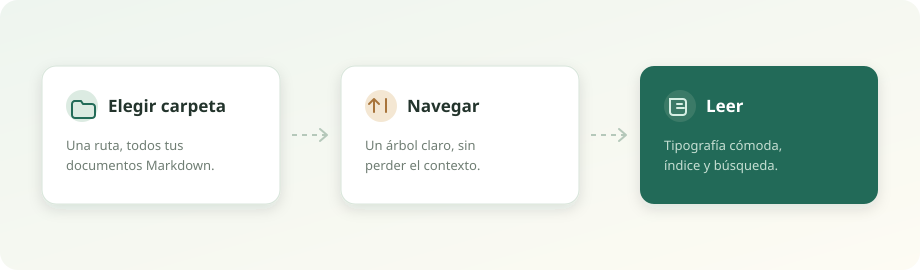

# Guía de Markdown

Esta guía reúne los elementos que Lector MD sabe mostrar. Sirve como referencia
rápida y como prueba visual del renderizador.

## Texto y énfasis

Puedes escribir texto normal, **negrita**, *cursiva*, ~~tachado~~, `código en línea`
y enlaces como [este ejemplo](https://commonmark.org/).

Los párrafos se separan con una línea en blanco. Las comillas rectas se convierten
en comillas tipográficas: "leer también es conversar".

### Un tercer nivel

Los encabezados del uno al cuatro aparecen en el índice lateral. Los niveles cinco
y seis se muestran en el documento, pero no se incluyen en el índice.

#### Detalles pequeños

Puedes usar `Ctrl + F` para buscar dentro del documento y `Esc` para cerrar la
búsqueda.

## Listas

### Lista con viñetas

- Un primer elemento
- Un segundo elemento
  - Una idea anidada
  - Otra idea anidada
- Un tercer elemento

### Lista numerada

1. Elegir una carpeta.
2. Recorrer los documentos.
3. Leer sin prisa.

### Lista de tareas

- [x] Abrir la aplicación
- [x] Elegir una carpeta
- [ ] Terminar de leer esta guía
- [ ] Compartirla con alguien

## Tablas

| Elemento | Sintaxis | Resultado |
| :--- | :--- | :--- |
| Negrita | `**texto**` | **texto** |
| Cursiva | `*texto*` | *texto* |
| Código | `` `texto` `` | `texto` |
| Enlace | `[texto](url)` | [texto](https://example.com) |
| Tachado | `~~texto~~` | ~~texto~~ |

Las tablas anchas se desplazan horizontalmente sin romper el diseño.

## Código

Los bloques de código conservan el resaltado de sintaxis y se pueden copiar con un
solo clic.

```python
from pathlib import Path

def documentos(carpeta: Path) -> list[Path]:
    """Devuelve los Markdown de una carpeta, ordenados."""
    return sorted(carpeta.rglob("*.md"), key=lambda p: p.name.lower())


for archivo in documentos(Path("C:/Mis documentos")):
    print(archivo.name)
```

```javascript
const lector = {
  carpeta: "C:/Notas",
  tema: "oscuro",
  abrir(archivo) {
    return fetch(`/api/documento?ruta=${encodeURIComponent(archivo)}`);
  },
};
```

```powershell
$carpeta = "C:\Mis documentos\Notas"
Get-ChildItem -Path $carpeta -Filter *.md -Recurse |
    Sort-Object Name |
    Select-Object Name, Length
```

También puedes usar código dentro de una frase: `python app.py --folder "C:\Notas"`.

## Citas y separadores

> Leer es una forma de conversar con alguien que ya pensó lo que a ti te preocupa.
>
> — Autor desconocido

> Una cita puede contener varios párrafos.
>
> Y también puede incluir **énfasis**, `código` y [enlaces](https://example.com).

---

## Enlaces e imágenes

### Enlaces internos

- [Volver a la bienvenida](Bienvenido.md)
- [Ir a los atajos](<Atajos y búsqueda.md>)
- [Abrir una nota en una subcarpeta](<Notas/Ideas para leer mejor.md>)

### Enlaces externos

- [CommonMark](https://commonmark.org/)
- [Documentación de Python](https://docs.python.org/es/3/)
- [GitHub](https://github.com/)

Los enlaces externos se abren en tu navegador. Los internos se abren dentro de
Lector MD, sin perder tu lugar.

### Imágenes



Las imágenes locales se leen desde la misma carpeta del documento. Puedes hacer
clic sobre una imagen para verla en grande.

## Notas al pie

Las notas al pie son útiles para aclaraciones que no quieres interrumpir la lectura.[^markdown]

[^markdown]: Este documento está escrito en Markdown estándar con extensiones GFM.

## Un cierre

No necesitas recordar toda la sintaxis. Lector MD se encarga de mostrarla; tú solo
ocúpate de escribir y de leer.
